<div align="right">
  <a href="README.md"></a>
  <a href="README.zh-CN.md"></a>
</div>

<p align="center">
  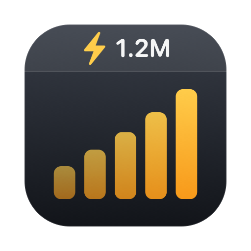
</p>

<h1 align="center">TokensBar</h1>

<p align="center">
  Your <a href="https://tokens.ci">tokens.ci</a> token usage and leaderboard rank, in the macOS menu bar — no browser tab needed.
</p>

<p align="center">
  <a href="https://github.com/lucaisgrowing/tokens-menubar/actions/workflows/build.yml"></a>
  <a href="https://github.com/lucaisgrowing/tokens-menubar/releases/latest"></a>
  <a href="LICENSE"></a>
  
  
</p>

Plain Swift, compiled with `swiftc`. No Xcode project, no dependencies beyond system frameworks.

## 1.12.0 Agent usage candidate (unreleased)

This candidate adds opt-in official local Codex quota reads and a Claude Code statusLine bridge, alongside submitted tokens.ci client data and optional OpenRouter per-key data. Muse Code cached reads are experimental here and are not the Muse personal agent. Meta Muse, Grok Bot, Cue and Wabi personal quotas are **not automatically connected**; the 67-entry reference catalog is not an integration count. Manual snapshots remain optional, not the automation solution.

It also adds a compact Usage & display window: truthful today/7-day comparisons, separate fetch/submission/CLI health, estimated-cost thresholds and notification frequency, and editable/persistent menu-bar order. Existing panel layout, fonts and green accent remain. Build 21 refines these four panes:

- Trends: an ink-green summary, side-by-side today/mean values, separate model contribution and scope notes.
- Data health: separate server/local cards with aligned attempt, success and submission rows, and contextual actions.
- Menu bar: a live composition preview, green check/order controls and at-least-one-item protection.
- Alerts: grouped thresholds and notification settings, an emphasized save action, and clear estimate/freshness/permission limits.

No new release or main merge; the v1.11.1 download does not include this candidate. See [sources, setup, tests and limits](docs/AGENT-USAGE.md).

<p align="center">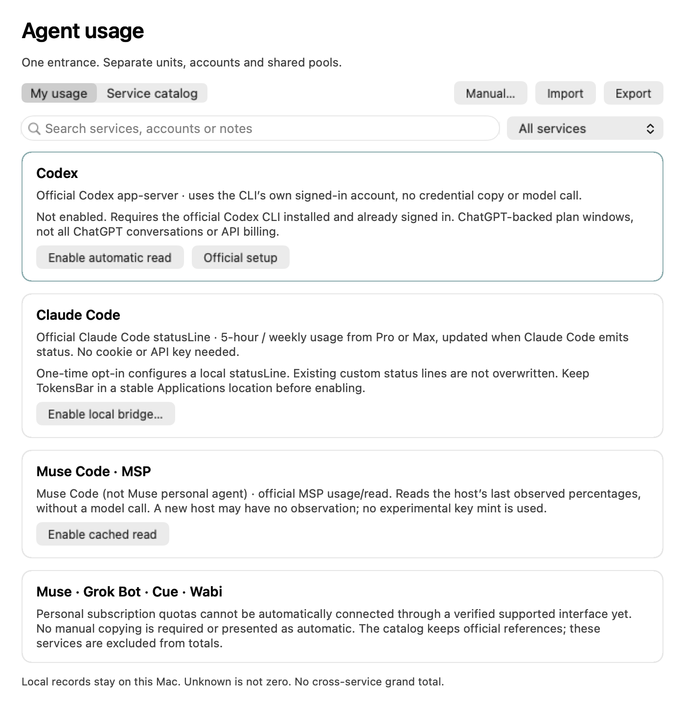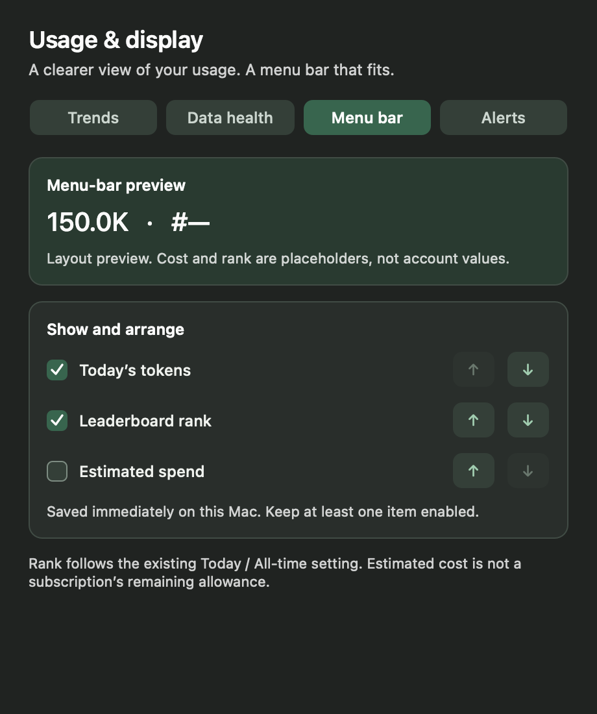</p>

<p align="center">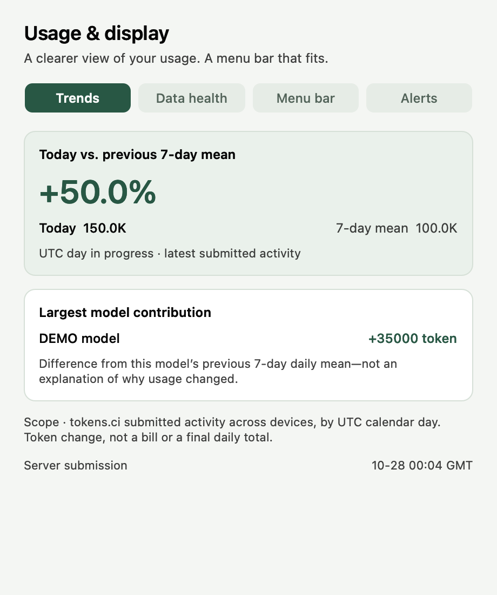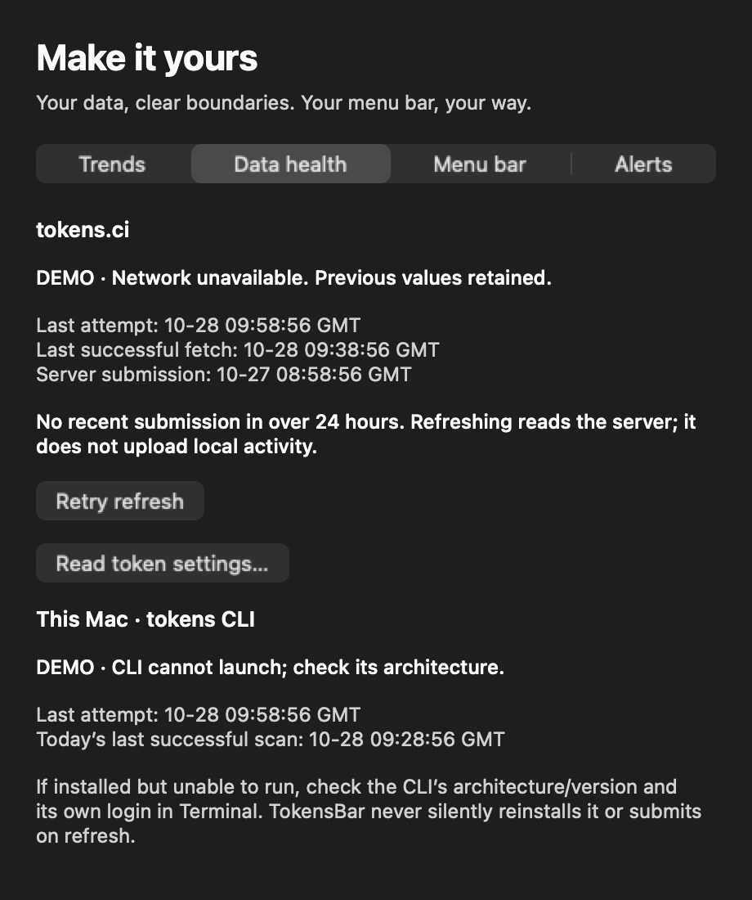</p>
<p align="center">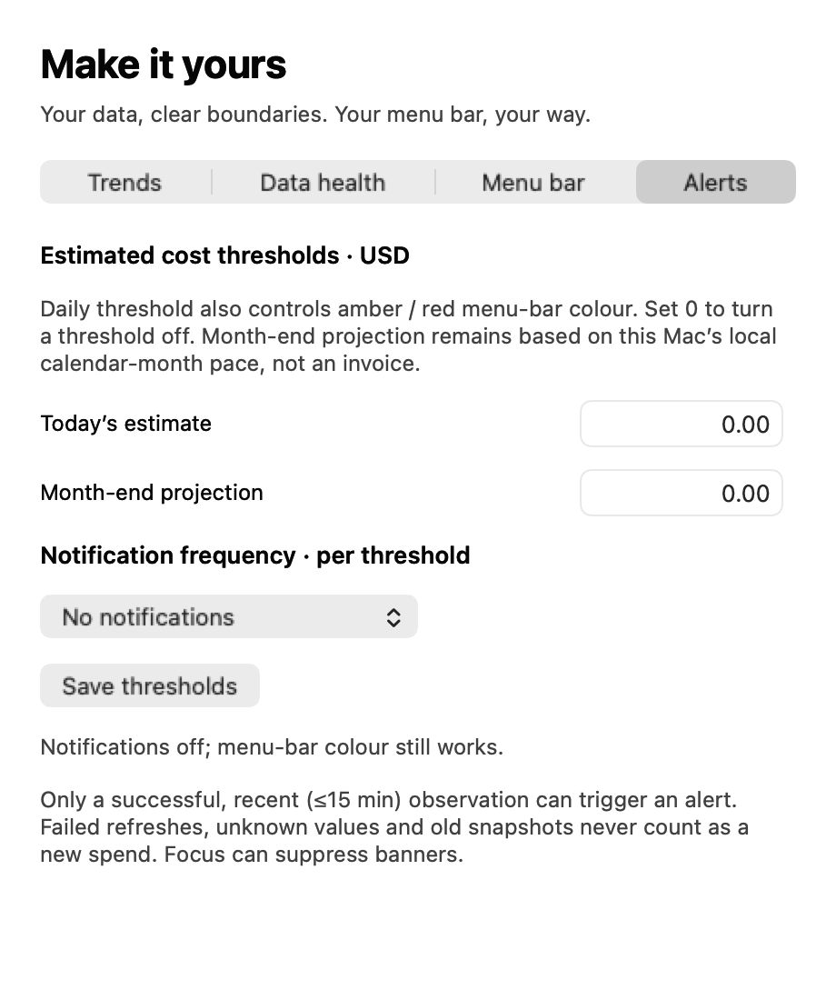</p>

These 2× native AppKit offscreen renders use synthetic fixtures and explicit failure/demo states, not connected account values. Authenticated account results, Keychain and notification delivery are not verified.

## What's new in 1.11.1

- Restore the original deep-green buttons and highlights, independent of the macOS system accent color; preserve light/dark styling, with more legible small green text in dark mode.

The following improvements from 1.11.0 are retained:

- Polish the existing teal interface without replacing its layout: a 360pt panel, cleaner spacing and cards, clearer progress bars, and the original system fonts, sizes and weights.
- Support private accounts with an optional read token stored in macOS Keychain, sent only to the configured HTTPS profile endpoint.
- Keep valid data visible when refreshes fail, distinguish successful fetches from refresh attempts, and explain network, authentication, not-found and rate-limit errors. API polling has a 60-second minimum (300 seconds by default).
- Make all-device vs. local-Mac totals, UTC days and estimated costs explicit; show nonzero model shares below one percent as `<1%`.
- Add press/drag-out feedback, interruptible charts, reduced-motion support and stronger high-contrast/opaque presentation. Correct the CLI documentation and add 45 pure-Swift regression checks.

[Download v1.11.1](https://github.com/lucaisgrowing/tokens-menubar/releases/tag/v1.11.1) · [Full changelog](CHANGELOG.md)

The README images below are 2× native AppKit offscreen renders of this **unreleased 1.12.0 build 21 candidate** on macOS, using synthetic `demo-user` API/CLI data—not a real account or Linux mockup. The diagnostic renderer uses a fixed backing surface in place of the live popover material. English and Chinese images are rendered separately. They do not show the published v1.11.1 download. [Reproduction and verification](docs/SCREENSHOTS.md).

> **Apple silicon:** use a native **arm64** `tokens` CLI, installed through Apple silicon Homebrew (`brew install owo-network/brew/tokens`). An Intel-only CLI needs Rosetta to run; TokensBar prefers a native installation when available and reports an unlaunchable CLI rather than a bare "submit failed".

<p align="center">
  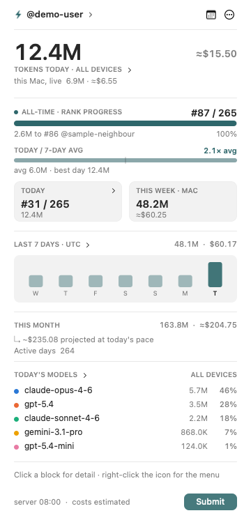
  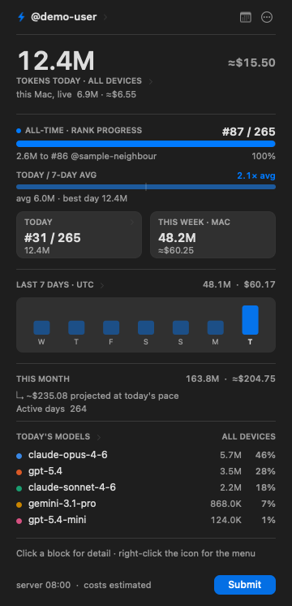
</p>

```
menu bar:  ⚡ 12.4M  #87       ← all-time rank
     or:   ⚡ 12.4M  D#31      ← today's rank
```

The token figure is today's total for the whole account, the same number the site shows, so it lines up with the rank beside it. Hover the icon for this machine's live figure as well.

English and 简体中文 are both built in — switch from the panel's actions page or the Language rows in the right-click menu (English is the default), or set `language` in the config file.

## The dropdown

Left-clicking the icon draws the panel above. Today's total leads, then the board
the menu bar is showing with the gap to the person one place up as a bar, today
against the average of the seven days before it, the other board and this week as
cards, the last seven days as bars, and today's model split in the same colours
the donut uses. Hovering a bar reads that day out next to the heading.

Clicking a section opens the matching view: the headline or the model list opens
the donut, the bars open the contributions grid, the card opens the other board's
breakdown. Clickable blocks carry a small chevron, and the line above the footer
names what the block under the pointer will open — with the pointer over nothing
it says how the panel works instead. **Submit** runs `tokens submit` and reports
the result in the footer, beside the last local and server refresh times.

Right-clicking the icon — or the ⋯ button in the panel — reaches the same set of
actions. The ⋯ button turns the panel to a second page rather than dropping a
menu over it: submit, refresh, the rank and language switches as pills, a
launch-at-login switch, the profile link, **Copy Stats Card** (a shareable image
of your standing, straight to the clipboard), the private-account read-token dialog, the update check, the tip page and
Quit, with **‹ Actions & Settings** back at the top and the build version at the
bottom. The two are cleanly split now — left-click the icon for the panel,
right-click it for the plain NSMenu, and nothing inside the panel reaches back
into that menu. The menu keeps the same verbs and their keyboard shortcuts, one
level deep: the numbers sit at the top of it, so the per-model breakdowns they
open are a single click from the menu bar, and the rank and language choices are
indented rows under a heading rather than submenus.

<p align="center">
  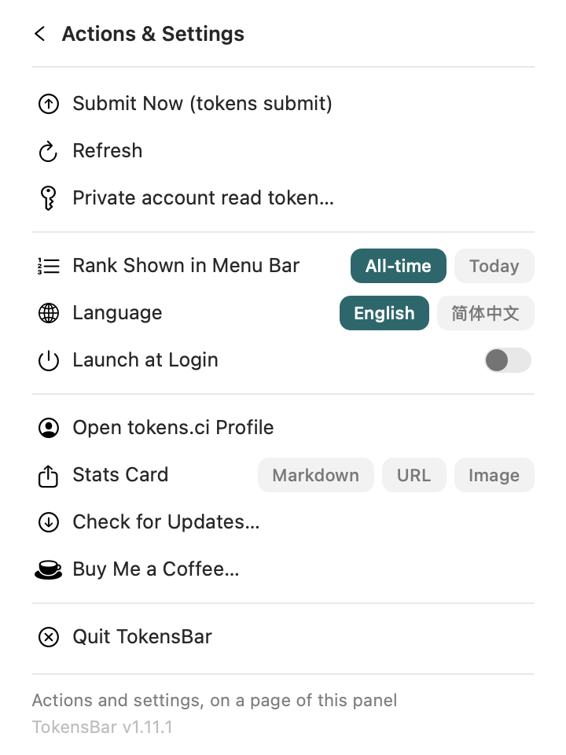
  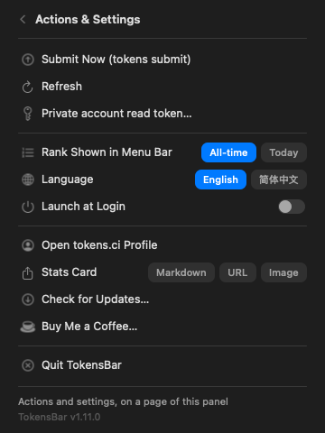
</p>

## Model distribution

Clicking the headline, or a model row — or the **Lifetime** / **Today** row in
the menu — opens a popover under the menu bar icon with a donut chart of the
per-model split, and a Tokens / Cost toggle:

- **Lifetime** comes from the API's `modelUsage`
- **Today** comes from the day's entry in the API's `contributions`, so it covers every device on the account — the same figure the Today row shows. Before the day's first submission it falls back to the local scan.

The top five models get their own slice and the rest fold into "Others" — a donut stops being readable much past six segments. With one or two models it draws a single 100% bar instead. Light and dark mode each get their own colour steps, chosen for contrast against that surface and checked for colour-blind separation.

The chart draws itself in when the popover opens and when the metric changes. Hovering a segment — or its legend row — highlights both, dims the rest, and swaps the centre readout to that model's own figure, so the value leads and the name follows.

<p align="center">
  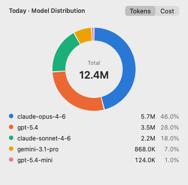
  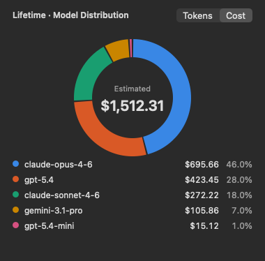
</p>

## Contributions

The seven-day bars in the panel — or the **Active days** row in the menu — open a year of daily token activity as a heat grid, the same view the site carries. Hovering a day reads out its tokens, cost, message count and per-client split; the pointer-free state shows the active-day count and the window covered.

<p align="center">
  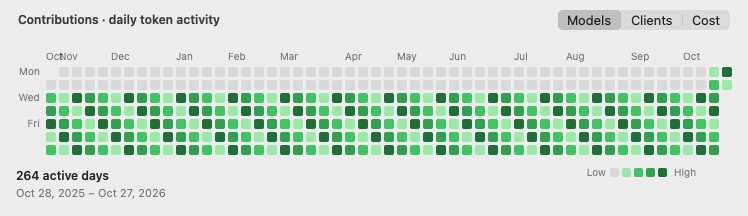
</p>

The contributions screenshot reflects the current source; the month-label spacing fix is not yet in the v1.11.1 release.

The toggle in the corner switches what the readout breaks the day down by — **Models**, **Clients** or **Cost**. Cost also recolours the grid: token intensity comes from the API, while the cost view derives its own levels from the quartiles of the daily spend, so a cheap-but-busy day and an expensive-but-quiet one look different.

The ramp is one hue, light to dark, with separate steps for light and dark mode; days with any usage never fall back to the empty-cell colour.

## The two ranks

- **All-time** — ranked by lifetime tokens. This is the board on the tokens.ci front page.
- **Today** — ranked by tokens submitted today only. Only people who submitted today are on it, so it is a smaller board and the rank moves more.

`#87 / 265` means rank 87 out of the 265 people on that board. In the menu bar a daily rank is prefixed (`D#31`, `今#31` in Chinese) to tell it apart from a lifetime one.

Pick which one the menu bar shows from the "Rank Shown in Menu Bar" row on the panel's actions page, or the rows under the same heading in the right-click menu (the choice is remembered), or set `menuBarRank` in the config file for the default. Both ranks are always shown; the setting only changes the menu bar line and which board the gap bar refers to.

When the board being shown moves between refreshes, a short banner reacts to it — a climb celebrates ("Passed @rival — now D#31", or a crown at #1) with a brief chip on the menu-bar readout (🚀+2 / 🎉 / 👑), a slip nudges. A background move never throws the panel open; the chip carries it at a glance.

## Requirements

The [`tokens`](https://github.com/missuo/tokens) CLI, installed and logged in:

```bash
brew install owo-network/brew/tokens
tokens login
```

## Install

Download `TokensBar.app.zip` from [Releases](https://github.com/lucaisgrowing/tokens-menubar/releases), unzip, move it to `/Applications`, then clear the quarantine flag:

```bash
xattr -dr com.apple.quarantine /Applications/TokensBar.app
open /Applications/TokensBar.app
```

The build is ad-hoc signed and **not** notarised, so macOS may block it under Gatekeeper. Only allow it if you trust this download. Alternatively, right-click → Open, or allow it in System Settings → Privacy & Security. The release binary is universal (arm64 + x86_64) and needs macOS 13 or newer.

Or build it yourself — nothing but the Swift toolchain that ships with Xcode is required:

```bash
git clone https://github.com/lucaisgrowing/tokens-menubar.git
cd tokens-menubar
./build.sh              # this Mac's architecture
./build.sh --universal  # arm64 + x86_64
open TokensBar.app
```

The app is an `LSUIElement`: no Dock icon. The menu-bar panel remains the main entrance; Agent usage and Usage & display open native utility windows.

The icon lives at `Resources/AppIcon.icns` and is committed. It is drawn in code — edit `Tools/make-icon.swift` and run `swift Tools/make-icon.swift` to regenerate it.

### Private accounts and data status

For private accounts, create a **read token** in tokens.ci Settings, then choose **Actions & Settings → Private account read token…** (also in the right-click menu). Paste the `tkr_…` token into the secure field. It is stored only in macOS Keychain, scoped to the configured username and HTTPS API origin. Use the same dialog to replace or remove it. Never put it in `config.json`, a query string, screenshots or bug reports. Token-bearing profile requests do not follow redirects. Public leaderboard requests never carry the token.

“Read HH:mm” means the last successful profile fetch, not the last refresh attempt or the server's last submission. Hover over the footer for all three times and the local scan time. On failure, old valid data stays visible with an explanation. A 404 can mean a private account **or** an unknown username; it is not evidence that today's usage is zero. The main figure uses submitted all-device data when available; the local line and week card describe this Mac. Costs are estimates (≈), not invoices. Daily server data uses UTC. API refresh settings below 60 seconds are clamped to 60.

### Offline checks

Run `Tests/run.sh` with Swift installed. This tests the actual Foundation parser/formatting/error helpers; it needs neither a CLI login nor a live API. The v1.11.1 macOS release workflow passed those 45 checks plus 10 native light/dark accent and contrast checks with a blue system preference, universal AppKit/Security compilation, bundle metadata checks and ad-hoc signature verification. The separate README snapshot workflow renders the published binary on macOS with synthetic local data. Neither replaces interactive UI, Keychain, private-account or real-CLI testing; those checks remain manual. Use `./build.sh --universal` and `--panel-probe` when checking changes on a Mac.

## Configuration

Optional, `~/.config/tokens-menubar/config.json`:

```json
{
  "username": "your-github-username",
  "language": "en",
  "menuBarRank": "all",
  "menuBarItems": ["tokens", "rank"],
  "dailyCostBudget": 0,
  "apiRefreshSeconds": 300,
  "localRefreshSeconds": 120,
  "topModels": 5
}
```

| Key | Default | Meaning |
| --- | --- | --- |
| `username` | read from `~/.config/tokens/credentials.json` | tokens.ci username |
| `apiBase` | `https://tokens.ci` | API base URL |
| `language` | `en` | UI language: `en` or `zh` |
| `menuBarRank` | `all` | Which rank the menu bar shows: `all` (lifetime) or `today` |
| `menuBarItems` | `["tokens", "rank"]` | What the menu-bar line shows, in order — any of `tokens`, `cost`, `rank` |
| `dailyCostBudget` | `0` | Colour the readout amber past this daily spend (USD), red at 1.5×; `0` is off |
| `apiRefreshSeconds` | 300 | How often to hit the API (minimum 60) |
| `localRefreshSeconds` | 120 | How often to run the local scan (minimum 30) |
| `topModels` | 5 | Models listed in the dropdown, 0 to list none |

Switching the rank or the language from the menu stores the choice in `UserDefaults`, which then wins over the config file. To hand control back: `defaults delete ci.tokens.menubar menuBarRank` (or `language`).

## Updates

"Check for Updates…" compares the bundle version against the latest GitHub release. A daily background check runs too; when a newer release exists the menu item turns into an install link.

Clicking it installs in place: it downloads that release's `TokensBar.app.zip`, checks the bundle inside really is the advertised version, swaps it for the running app and relaunches — no browser, no unzip, no drag into `/Applications`, and no quarantine flag to clear. It asks first, and nothing is ever installed without that confirmation. If the app sits somewhere this account cannot write, or the release has no zip attached, the release page opens instead, exactly as it did before.

The updater trusts HTTPS to GitHub and checks the bundle version; it does not verify the download's code signature or the release checksum. The release also includes `SHA256SUMS.txt` for manual download-integrity checks (`shasum -a 256 -c SHA256SUMS.txt`, in the directory containing the ZIP). A checksum hosted beside the download does not independently authenticate the publisher. The app remains ad-hoc signed, without Developer ID signing or Apple notarisation.

## Command line

```bash
# Print the menu bar line, the whole dropdown and both chart breakdowns to
# stdout — useful for checking the data path without the GUI.
./TokensBar.app/Contents/MacOS/TokensBar --dump [--lang en|zh]

# Render the chart popover offscreen to a PNG, to preview the layout.
# `dark` renders dark mode, `hover N` the highlight for slice N, `reveal F`
# freezes the draw-in animation at progress F.
./TokensBar.app/Contents/MacOS/TokensBar --chart-png out.png \
    [today|lifetime] [tokens|cost] [dark] [hover N] [reveal F]

# Render the contributions grid offscreen.
./TokensBar.app/Contents/MacOS/TokensBar --contrib-png out.png \
    [models|clients|cost] [dark] [hover YYYY-MM-DD]

# Render the shareable stats card offscreen (the "Copy Stats Card" menu item).
./TokensBar.app/Contents/MacOS/TokensBar --share-png out.png [light]

# Render the dropdown panel offscreen, and print its clickable regions — a still
# image cannot show where a click lands. `dark` renders dark mode, `menu` the
# actions page, `hover N` the readout for day N of the seven (0 = oldest), `hit N`
# the hover state of clickable region N, which is what the hint line reacts to.
./TokensBar.app/Contents/MacOS/TokensBar --panel-png out.png [dark] [menu] [hover N] [hit N] [notice success|failure|info TEXT]

# Open the panel for real against a throwaway anchor and print its live geometry,
# optionally capturing the popover window. This is what catches the panel sitting
# off-centre: the popover insets its content view, so the sizes it reports and the
# sizes asked for are not the same thing. `menu` turns to the actions page while
# it is open, which is what resizes a shown popover.
./TokensBar.app/Contents/MacOS/TokensBar --panel-probe [out.png] [menu]

# Print the menu as a tree, with indented rows shown at their indent level.
./TokensBar.app/Contents/MacOS/TokensBar --menu-dump

# Compare this build against the latest GitHub release.
./TokensBar.app/Contents/MacOS/TokensBar --check-updates

# Download, verify and install the latest release over this bundle, then relaunch.
# Same path the update menu item takes, minus the click and the confirmation, so
# point a throwaway copy at it rather than the app you use.
./TokensBar.app/Contents/MacOS/TokensBar --self-update

# Run the same submit the menu item runs, to reproduce a failure in a terminal.
# Add --dry-run to send nothing.
./TokensBar.app/Contents/MacOS/TokensBar --submit [--dry-run]

# Launch at login (installs/removes ~/Library/LaunchAgents/ci.tokens.menubar.plist)
./TokensBar.app/Contents/MacOS/TokensBar --set-login on
./TokensBar.app/Contents/MacOS/TokensBar --set-login off
```

The "Launch at Login" checkbox in the menu does the same thing as `--set-login`.

## How it works

Two data sources:

- **The API** — the public read-only endpoints `GET /api/users/<name>` and `GET /api/leaderboard?period=all|today`. Both ranks, the lifetime totals, the model split, the contributions grid, and **today's totals**. Public reads send no credentials; only the profile request can send your optional Keychain read token in an Authorization header.
- **The local CLI** — `tokens submit --dry-run --today`, `--week`, and `--month` (human-readable text; parsed locally, nothing submitted). This week, and today on this machine.

Two things worth knowing:

- Percentages in the dropdown are a share of tokens, recomputed locally. The API's own percentages are a share of cost, so the two can differ.
- The **Today** row is the server's figure, so it agrees with the daily rank and with the site: every device on the account, as of the last submission. The dim line under it is this machine's live scan. The two differ in both directions — another machine's usage is in the first but not the second, and anything done since the last submission is in the second but not the first. The token gap can be far larger than the cost gap, because a cache-heavy free model contributes millions of tokens for almost nothing.

If the API cannot be reached, the dropdown reports that the server read failed and keeps the last figures it had.

## Support

TokensBar is free and stays free. If it saved you a browser tab, USDT tips are welcome on either chain:

| Chain | Address |
| --- | --- |
| TRON (TRC20) | `TNKSjygE7JaMSJBPZcYPpWxVPUKrFr8DDU` |
| Ethereum · BNB Chain · Base (ERC20 / BEP20) | `0x027E4828B67f4c8cAc006A637Cab4f0164F501B8` |

<table align="center">
  <tr>
    <td align="center"><br><sub>TRON (TRC20)</sub></td>
    <td align="center"><br><sub>ERC20 / BEP20 / Base</sub></td>
  </tr>
</table>

Check the chain before sending — the two addresses are not interchangeable.

## Credits

TokensBar is only a menu bar front end. All the actual usage accounting is done by:

- [missuo/tokens](https://github.com/missuo/tokens) — the `tokens` CLI this app calls, and the [tokens.ci](https://tokens.ci) leaderboard itself (MIT)
- [junhoyeo/tokscale](https://github.com/junhoyeo/tokscale) — upstream of `missuo/tokens` (MIT)

No code from either project is copied here; TokensBar only reads their CLI output and public read-only API. Not affiliated with tokens.ci.

## License

[MIT](LICENSE), matching both upstream projects.


